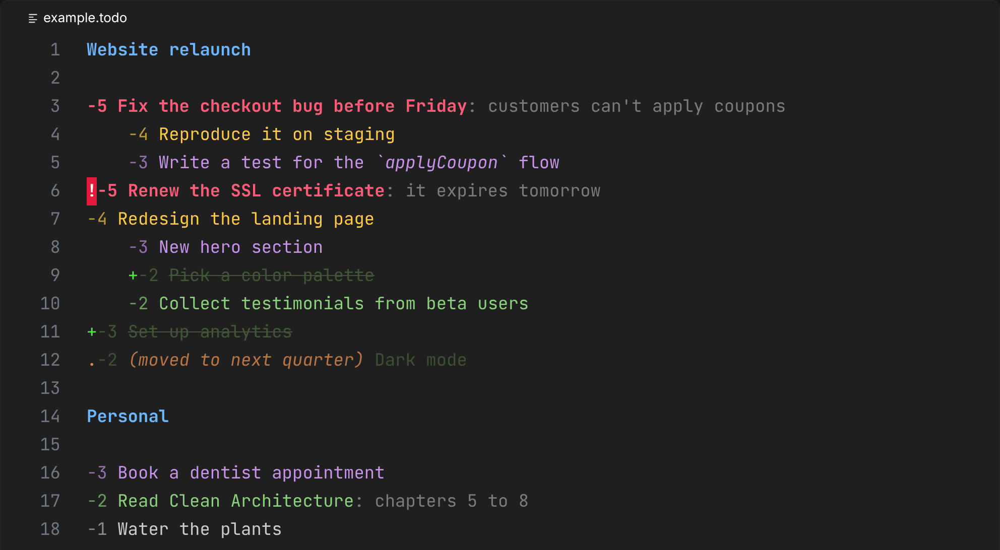
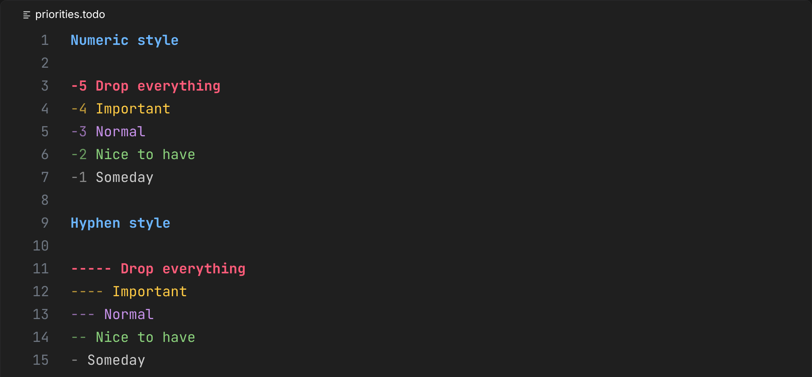
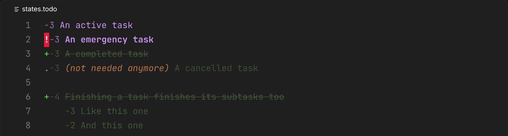
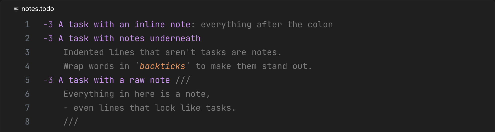
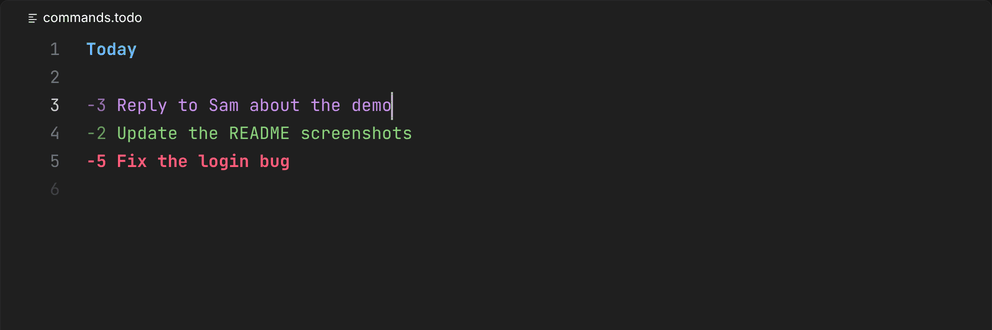
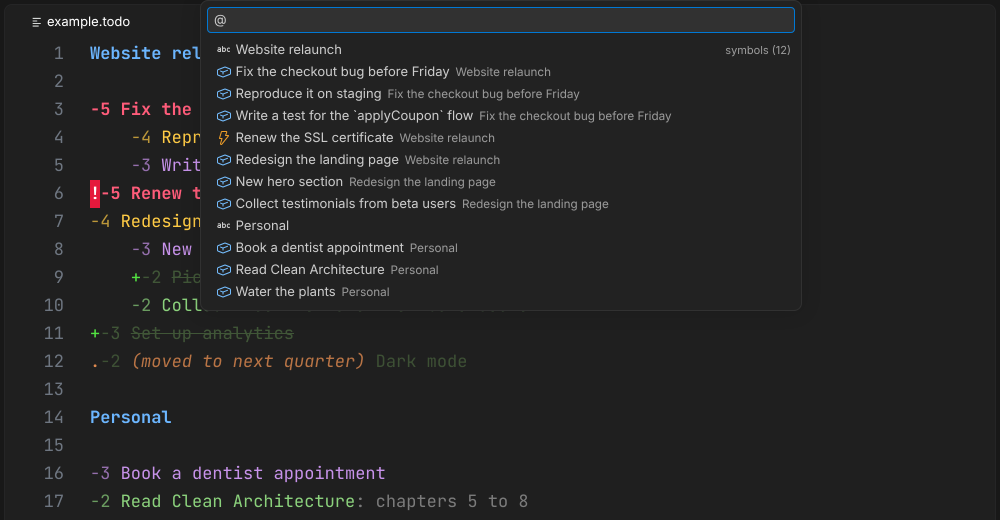
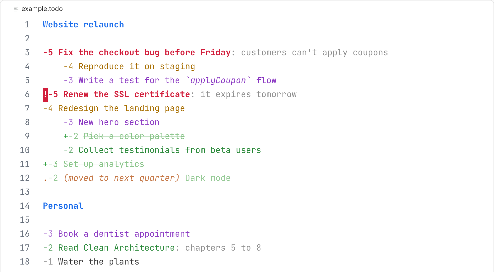

# ToDone for VS Code

ToDone for VS Code is an unofficial VS Code port based on the original [ToDone](https://github.com/tiffon/sublime-to-done) package for Sublime Text by tiffon.

All credit for the ToDone format, its syntax and the idea behind it goes to the original author. This project brings that workflow to VS Code and is not affiliated with or endorsed by the original project. If you use Sublime Text, grab the original package from [Package Control](https://packagecontrol.io/packages/ToDone).



## Hey there! 👋

I use ToDone in Sublime Text all the time. It's the simplest way I know to keep a to-do list: a plain text file where every line starts with a priority, and the editor does the rest. I wanted the exact same thing in VS Code, so here it is. 🙂

🟪 **Plain text.** Your list is just a `.todo` file. No accounts, no database, no sync service.

🟪 **Five priority levels**, written as `-1` to `-5` or `-` to `-----`. Both look identical.

🟪 **Emergency, completed and cancelled** tasks, with subtasks that follow their parent.

🟪 **Notes** next to or under any task.

🟪 **Colors that work in any theme**, dark or light.

🟪 **Commands and an outline** so you can manage tasks without leaving the keyboard.

🟣 **Compatible with Sublime ToDone.** The same file opens in both editors.

## Quick start

1. Install **ToDone for VS Code** from the Extensions view (<kbd>Ctrl</kbd>+<kbd>Shift</kbd>+<kbd>X</kbd>).
2. Create a file that ends in `.todo` or `.todone`.
3. Start typing:

   ```text
   Today

   -5 Something urgent
   -3 Something normal: with a note
   -1 Something that can wait
   ```

4. Put your cursor on a task and press <kbd>Ctrl</kbd>+<kbd>/</kbd> to mark it done. That's it! 🎉

The rest of this page explains everything ToDone can do.

## Priorities

There are five priority levels. **5 is the most important** and **1 is the least important**. Each level can be written in two ways, and both look exactly the same:

| Priority | Numeric | Hyphens |
| --- | --- | --- |
| 5 (highest) | `-5` | `-----` |
| 4 | `-4` | `----` |
| 3 | `-3` | `---` |
| 2 | `-2` | `--` |
| 1 (lowest) | `-1` | `-` |



Use whichever style you like, or mix them in the same file. The marker just needs a space or a tab after it.

## States

Put one character in front of the marker to change a task's state. States work with both priority styles.

| Prefix | State | What it looks like |
| --- | --- | --- |
| `!` | Emergency | The `!` gets a red background and the title turns bold. |
| `+` | Completed | The task is dimmed and crossed out. |
| `.` | Cancelled | The task is dimmed. Text in parentheses right after the marker is shown as the reason. |



You can combine them too. For example, `+!-5` is a completed task that used to be an emergency.

## Subtasks

Indent a task under another one to make it a subtask. Spaces and tabs both work.

```text
-4 Parent task
    -3 Child task
        -2 Grandchild task
```

Completing or cancelling a task also completes or cancels everything nested under it.

## Notes

A task can carry notes in three ways:



1. **Inline:** everything after a colon `:` on the task's line.
2. **Underneath:** indented lines below a task that aren't tasks themselves.
3. **Raw:** everything between two `///` markers. Use this when your note has lines that start with `-` or `+` and you don't want them treated as tasks.

Wrap words in backticks, like `` `this` ``, to make them stand out in a note. Links such as `https://example.com` can go in a task title without starting a note.

## Headings

Any line that starts at the left edge and isn't a task is a heading. Use headings to group your tasks.

```text
Work
-3 Finish the report

Home
-2 Fix the leaky tap
```

Text between `/*` and `*/` at the start of a line also forms a heading, and it can span several lines.

## Commands

Open the Command Palette (<kbd>Ctrl</kbd>+<kbd>Shift</kbd>+<kbd>P</kbd>) and type **ToDone** to see every command.



| Command | What it does |
| --- | --- |
| ToDone: Toggle Completed | Adds or removes `+`. Also on <kbd>Ctrl</kbd>+<kbd>/</kbd> (<kbd>Cmd</kbd>+<kbd>/</kbd> on macOS). |
| ToDone: Toggle Emergency | Adds or removes `!`. |
| ToDone: Toggle Cancelled | Adds or removes `.`. |
| ToDone: Increase Priority | Raises the priority by one, up to 5. |
| ToDone: Decrease Priority | Lowers the priority by one, down to 1. |
| ToDone: Set Priority 1 to 5 | Sets an exact priority. On a plain line of text, this turns the line into a task. |

Good to know:

- Commands work on **every selected line** and on **every cursor** when you use multiple cursors.
- They **keep your notation**. Raising `-4` gives `-5`, and raising `----` gives `-----`. A numeric task never turns into hyphens unless you ask for it with the `todone.priorityStyle` setting.
- Indentation, titles, notes and cancellation reasons are never touched.
- Toggles on several tasks work like VS Code's comment toggle: the state is added to all of them, unless they all have it already, in which case it's removed from all of them.
- Completed and cancelled can't both apply. Completing a cancelled task removes the `.`, and cancelling a completed task removes the `+`.

### Keyboard shortcuts

Only <kbd>Ctrl</kbd>+<kbd>/</kbd> is set up out of the box, and only inside ToDone files. Want more? Open the Command Palette, run **Preferences: Open Keyboard Shortcuts (JSON)** and add the ones you like:

```json
[
  { "key": "ctrl+alt+up", "command": "todone.increasePriority", "when": "editorLangId == todone" },
  { "key": "ctrl+alt+down", "command": "todone.decreasePriority", "when": "editorLangId == todone" },
  { "key": "ctrl+alt+1", "command": "todone.setPriority1", "when": "editorLangId == todone" },
  { "key": "ctrl+alt+5", "command": "todone.setPriority5", "when": "editorLangId == todone" },
  { "key": "ctrl+alt+e", "command": "todone.toggleEmergency", "when": "editorLangId == todone" },
  { "key": "ctrl+alt+x", "command": "todone.toggleCancelled", "when": "editorLangId == todone" }
]
```

To turn off the <kbd>Ctrl</kbd>+<kbd>/</kbd> shortcut, add `{ "key": "ctrl+/", "command": "-todone.toggleCompleted" }` to the same file.

## Finding your way around

Press <kbd>Ctrl</kbd>+<kbd>Shift</kbd>+<kbd>O</kbd> (**Go to Symbol in Editor**) to jump to any task. Your tasks also show up in the **Outline** view and in the breadcrumbs above the editor. Subtasks are nested under their parents and tasks are grouped under their headings.



Completed and cancelled tasks are left out, so you only see what's still on your plate. You can bring them back with the settings below.

## Colors

ToDone comes with its own colors, so your priorities and states stay easy to tell apart in any theme. There are separate colors for dark, light and high contrast themes.



Want different colors? Change any of them in your settings under `workbench.colorCustomizations`. For example, to make priority 5 orange and headings green:

```json
"workbench.colorCustomizations": {
  "todone.priority5Foreground": "#ff8c00",
  "todone.headingForeground": "#4caf50"
}
```

<details>
<summary>All the colors you can change</summary>

| Color | Used for |
| --- | --- |
| `todone.priority1Foreground` to `todone.priority5Foreground` | Task titles and markers for each priority |
| `todone.markerForeground` | The marker of a priority 1 task |
| `todone.emergencyForeground` | The `!` of an emergency task |
| `todone.emergencyBackground` | The background behind the `!` |
| `todone.completedForeground` | The `+` of a completed task |
| `todone.cancelledForeground` | The `.` of a cancelled task and its reason |
| `todone.noteForeground` | Notes |
| `todone.emphasisForeground` | Text in backticks inside notes |
| `todone.headingForeground` | Headings |

Theme-specific blocks such as `"[Default Dark Modern]": { ... }` work as usual.

</details>

### Using your theme's colors instead

Prefer your theme's own colors? Set `"todone.colors": "theme"`. Keep in mind that some themes use the same color for several things, so priorities can blur together. You can fix that by targeting ToDone's scopes with `editor.tokenColorCustomizations`:

```json
"editor.tokenColorCustomizations": {
  "textMateRules": [
    { "scope": "meta.title.priority-2", "settings": { "foreground": "#c5ffa0" } },
    { "scope": "meta.title.priority-5", "settings": { "foreground": "#f92672", "fontStyle": "bold" } },
    { "scope": "meta.note.todone", "settings": { "foreground": "#75715e" } }
  ]
}
```

Run **Developer: Inspect Editor Tokens and Scopes** on any part of a task to see its scopes.

## Settings

| Setting | Default | What it does |
| --- | --- | --- |
| `todone.colors` | `builtin` | `builtin` uses ToDone's own colors in any theme. `theme` uses your color theme's colors. |
| `todone.priorityStyle` | `preserve` | How commands write priority markers. `preserve` keeps each task's current style and uses the numeric style for new tasks. `numeric` always writes `-3`. `hyphens` always writes `---`. |
| `todone.outline.showCompletedTasks` | `false` | Show completed tasks in the outline and in Go to Symbol. |
| `todone.outline.showCancelledTasks` | `false` | Show cancelled tasks in the outline and in Go to Symbol. |

## Installing from a VSIX file

Every [GitHub release](https://github.com/DanielKhojaste/ToDone/releases) has a `.vsix` file attached. To install one, run:

```powershell
code --install-extension todone-vscode-0.2.2.vsix
```

You can also use **Extensions: Install from VSIX...** from the Command Palette.

## Development

Want to poke around the code? Here's how to get going:

```powershell
npm install
npm test                  # lint, grammar check, unit and grammar tests
npm run test:integration  # runs the extension tests inside a downloaded copy of VS Code
npm run package           # builds the .vsix file
```

To try your changes, open the project folder in VS Code and press <kbd>F5</kbd> (or choose **Run Extension** in the Run and Debug view). A second VS Code window titled "[Extension Development Host]" opens with the extension loaded and the sample files from `test/fixtures` ready to go. The **Extension Tests** configuration runs the integration tests the same way.

The grammar in `syntaxes/todone.tmLanguage.json` is generated by `scripts/build-grammar.js`, so edit the script and run `npm run grammar` instead of editing the JSON by hand.

## Differences from Sublime ToDone

- **Blank lines inside a task.** In the original package, a blank line ended a task's block, so a completed or cancelled state didn't carry over to subtasks after a blank line. Here, nesting is decided by indentation alone, so those subtasks are dimmed too. The outline follows the same rule.
- **Numeric markers on finished tasks.** The original grammar didn't fully recognize forms such as `+-5`, and subtasks written as `-3` inside a completed or cancelled task only had their hyphen styled. Both work consistently here.
- **Completed titles** are crossed out.
- **Emphasis in titles.** With `"todone.colors": "theme"`, backtick text is also highlighted in task titles, not only in notes.
- **Your theme stays yours.** The original package switched your whole editor to its own color scheme and set an 8-column hard-tab layout. This port only colors ToDone files and leaves your settings alone.

## Feedback

Found a bug or have an idea? [Open an issue](https://github.com/DanielKhojaste/ToDone/issues) and tell me about it. I'd love to hear how you use ToDone! 😎

## Credits and license

ToDone was created by Joe Farro ([tiffon](https://github.com/tiffon)) for Sublime Text and is released under the MIT License. The grammar in this extension is a port of the original `ToDone.tmLanguage`, and its license notice is included in [THIRD_PARTY_NOTICES.md](THIRD_PARTY_NOTICES.md). The test fixture `test/fixtures/original-readme.todo` is adapted from the original package's `readme.todo`.

- Original repository: <https://github.com/tiffon/sublime-to-done>
- Package Control: <https://packagecontrol.io/packages/ToDone>

This extension is released under the [MIT License](LICENSE).
